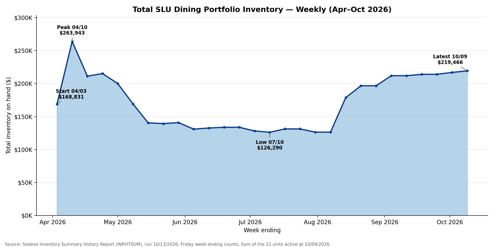
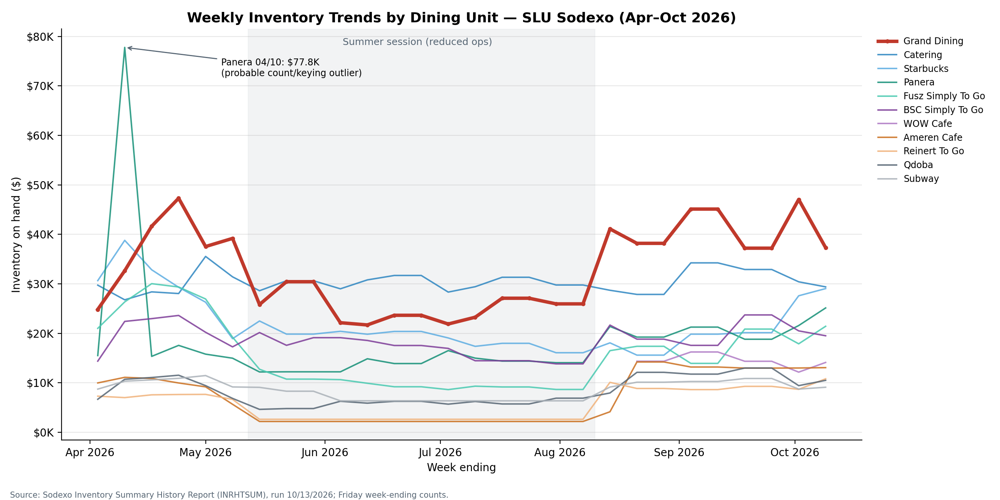
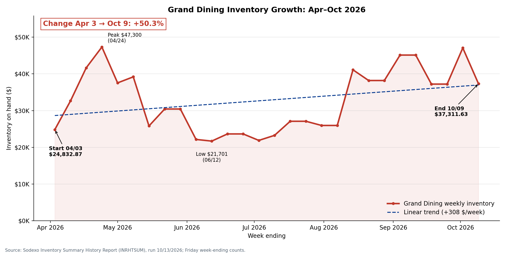
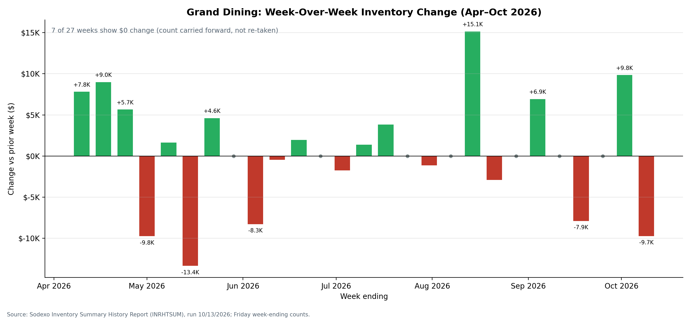
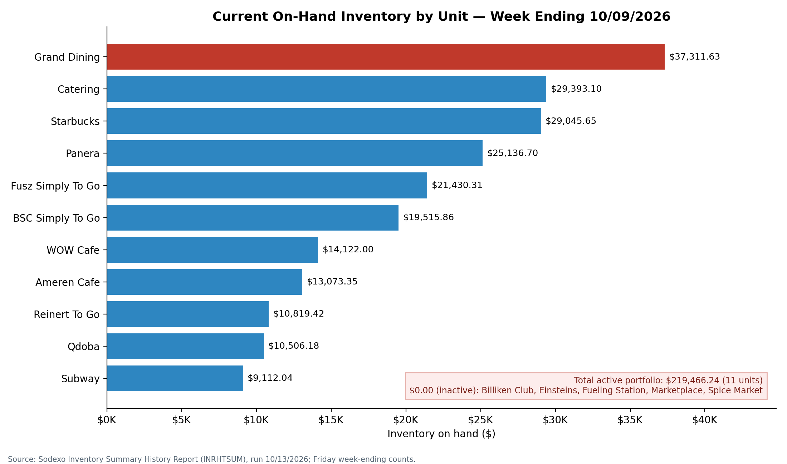
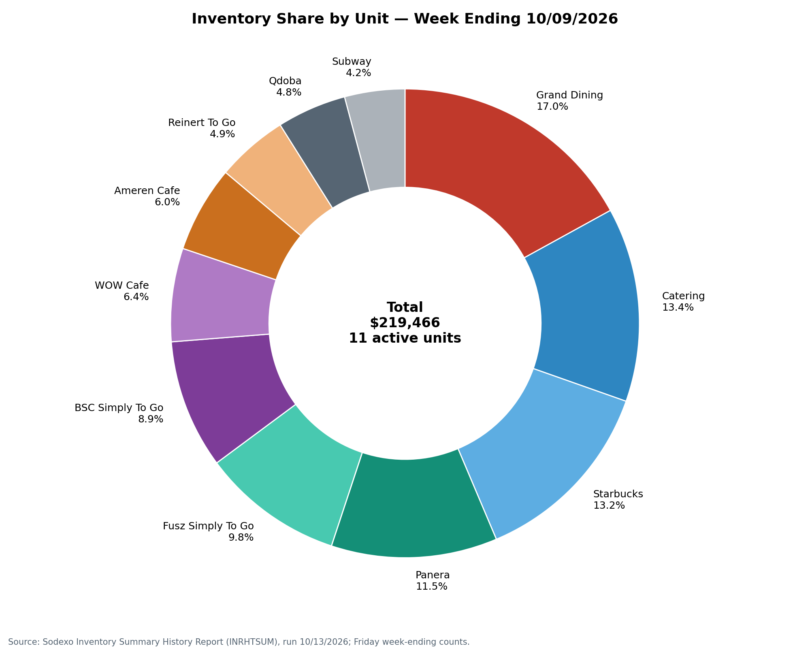
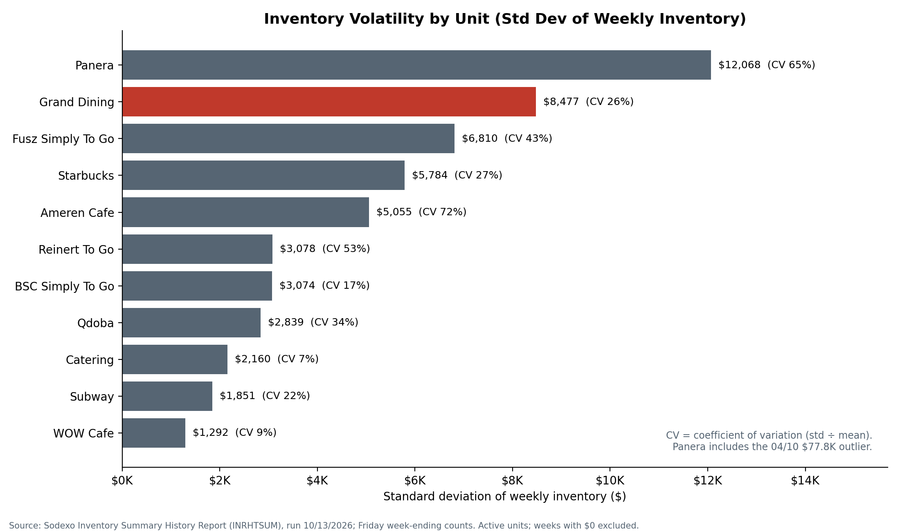
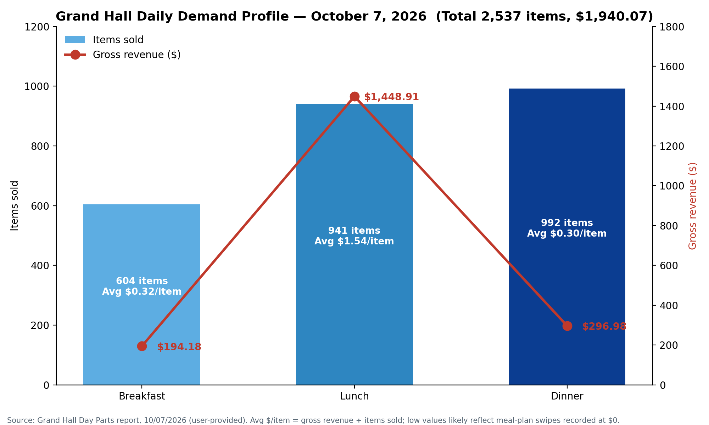
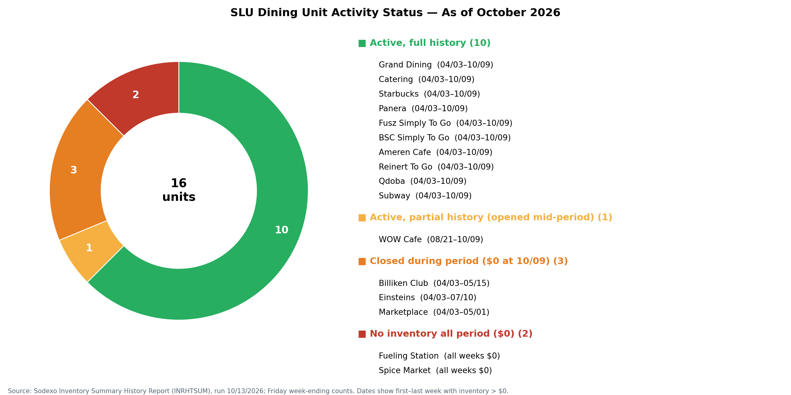
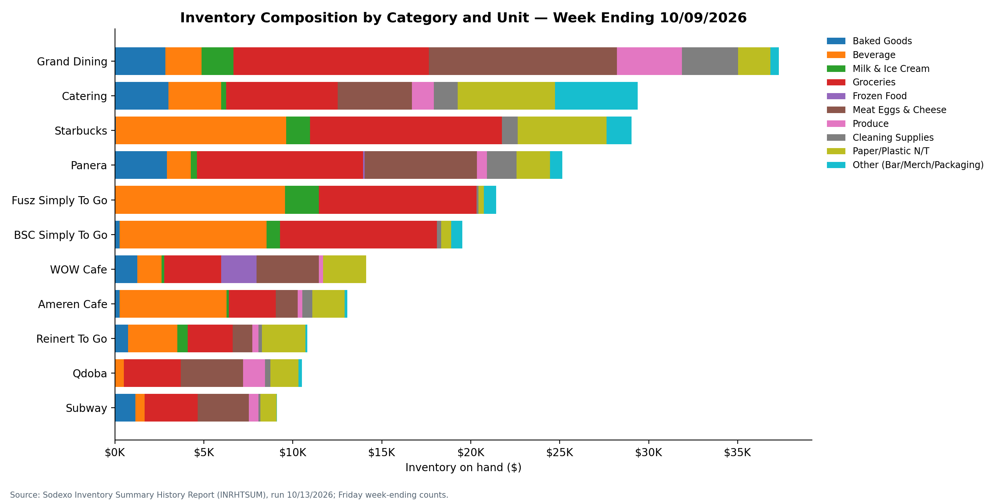

# Detailed Findings, with All 12 Charts

**Olawale Ajibola Ashaolu, Data Analyst, Sodexo, Saint Louis University Dining Services**
Data: Sodexo Inventory Summary History Report (INRHTSUM, run 10/13/2026), W/E 04/03/2026 to 10/09/2026; Grand Hall Day Parts Report (10/07/2026).

## 1. Portfolio inventory trend

- Portfolio inventory opened at **$168,831.09** (W/E 04/03).
- It peaked at **$263,943.40** a week later (04/10). Most of that peak comes from the Panera outlier.
- It fell to a summer low of **$126,289.65** (07/10), then recovered to **$219,466.24** by 10/09.
- The weekly mean is **$171,901.68**.
- The summer dip tracks the academic calendar, so any forecasting model has to include calendar effects.

## 2. Weekly trends by unit

- **Grand Dining** rises steadily over the whole period.
- **Starbucks** is volatile: it dropped to $15,598.65, then recovered toward its opening level.
- **Catering** stays flat around its $30,409.91 mean.
- **Panera** spikes on 04/10, then returns to its normal range.
- **WOW Cafe & Wingery** has data only from 08/21 (8 weeks).

## 3. Grand Dining: six-month growth and week-over-week change

- Inventory went from $24,832.87 to $37,311.63, a gain of **$12,478.76 (+50.25%)**.
- The trend is **+$307.67 per week**, about $1,330 per month. No documented growth in demand explains it.
- The range is $21,700.53 to $47,299.91 ($25,599.38). Standard deviation is $8,477.02 on a mean of $32,812.42, a CV of 0.26.
- **7 of 27** week-over-week changes were exactly $0.00, a 26% stale rate.

## 4. Current snapshot (W/E 10/09/2026)

| Unit | Latest | Share | Mean | Growth vs. start |
|---|---|---|---|---|
| Grand Dining | $37,311.63 | 17.0% | $32,812.42 | +50.25% |
| Catering | $29,393.10 | 13.4% | $30,409.91 | −1.16% |
| Starbucks | $29,045.65 | 13.2% | $21,802.77 | −5.24% |
| Panera | $25,136.70 | 11.5% | $18,704.19 | +62.0% |
| Fusz Simply To Go | $21,430.31 | 9.8% | $15,713.77 | +2.0% |
| BSC Simply To Go | $19,515.86 | 8.9% | $18,589.75 | +35.7% |
| WOW Cafe & Wingery | $14,122.00 | 6.4% | $14,525.81 | −1.7% (8 weeks) |
| Ameren Cafe | $13,073.35 | 6.0% | $7,014.90 | +31.0% |
| Reinert To Go | $10,819.42 | 4.9% | $5,762.71 | +48.0% |
| Qdoba | $10,506.18 | 4.8% | $8,363.05 | +57.3% |
| Subway | $9,112.04 | 4.2% | $8,577.98 | +4.3% |
| **Total (11 active)** | **$219,466.24** | 100% | — | — |

The top three units hold **43.6%** of the total. Catering and Starbucks each carry nearly as much as the residential hall, even though their demand profiles are very different.

## 5. Volatility

- **Panera** has the highest σ ($12,068), driven by the outlier.
- Among the large units, **Grand Dining** ($8,477) and **Starbucks** ($5,784) are the most volatile in practice.
- **Ameren Cafe** (CV 0.72) and **Reinert To Go** (CV 0.53) swing the most relative to their size.
- **Catering** (0.07) and **WOW** (0.09) are the most stable.

## 6. Count freshness (stale counts)

- **Reinert To Go** and **Ameren Cafe**: 56% of weeks unchanged from the prior week (15 of 27).
- **Subway**: 48% (13 of 27).

Records like these cannot be trusted for forecasting or financial reporting until weekly physical counts are enforced (Recommendation 2).

## 7. Demand profile: Grand Hall Day Parts (10/07/2026)

| Meal period | Items | Food revenue | Gross | Avg check | Control count |
|---|---|---|---|---|---|
| Breakfast | 604 | $189.68 | $194.18 | $0.32 | 604 |
| Lunch | 941 | $1,426.92 | $1,448.91 | $1.55 | 937 |
| Dinner | 992 | $290.83 | $296.98 | $0.30 | 992 |
| **Total** | **2,537** | **$1,907.43** | **$1,940.07** | — | 2,533 |

- Dinner has the highest volume (39.1% of items) and the lowest cash yield.
- Lunch brings in **74.8% of food revenue**. Lunch draws more retail and cash transactions, while most Breakfast and Dinner transactions are meal-plan swipes at about $0.
- The kitchen is staffed and stocked for peak volume at the meal with the least cash revenue. Demand forecasting can right-size production for that.

## 8. Procurement gap

- Grand Hall has two templates, **Produce** and **Sysco**, with 409 lines each on a Mon/Wed/Fri cadence.
- **0 of 409 PAR levels** are set and **0 of 1,227 order slots** are logged. Every order is placed on judgment, with no target.
- This is the single most critical operational gap.

## 9. Unit activity and catalog health

- 16 units in total:
  - 11 active (WOW Cafe partial)
  - 3 closed: Billiken Club and Grill, Marketplace, legacy Einsteins
  - 2 never active: Spice Market, Fueling Station
- In the revenue-center catalog, 95.6% of button records are inactive, and the duplication factor is 4.13×.

## 10. Category mix

- Portfolio mix: Groceries 32%, Beverage 20%, Meat/Eggs/Cheese 15%, Paper/Plastic N/T 11%, Baked Goods 6%, Cleaning 4%, Other 4%, Produce 4%, Milk & Ice Cream 3%, Frozen 1%.
- Starbucks is mostly Beverage. Grand Dining is mostly Groceries and Meat/Eggs/Cheese.
- Frozen at 1% is unusually low. Check it during the PAR exercise: it may reflect a fresh-forward menu or a classification issue.

**What to do about these findings:** see [RECOMMENDATIONS.md](RECOMMENDATIONS.md).
