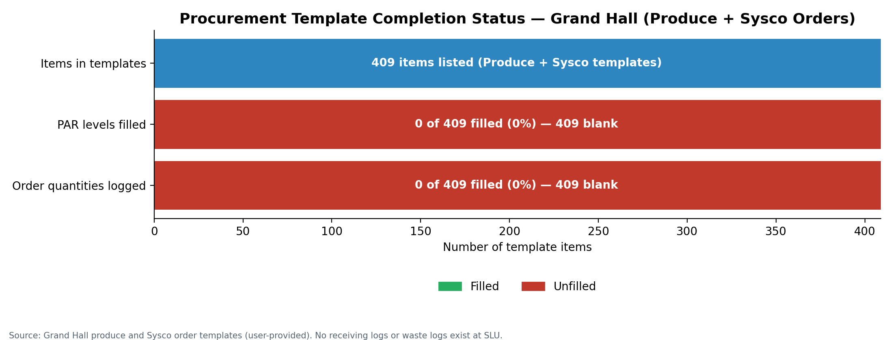
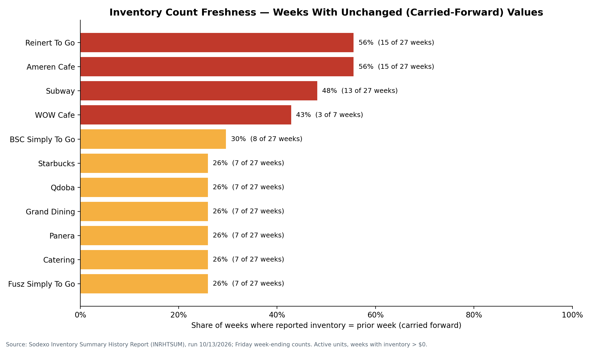

# Sodexo SLU Dining: Inventory & Demand Analytics (Phase I)

**Integrated Demand Forecasting & Supply Optimization for Multi-Outlet Campus Dining Operations at Saint Louis University**

**Author:** Olawale Ajibola Ashaolu, Data Analyst, Sodexo, Saint Louis University Dining Services
**Period analyzed:** W/E 04/03/2026 to W/E 10/09/2026 (28 Friday weeks plus 5 month-end closes)
**Published:** October 2026, with approval from the Director of Operations – Retail, Sodexo SLU Dining

---

## Why this project exists
This repository is the documented **Phase I** of my EB-2 National Interest Waiver proposed endeavor:

> My proposed endeavor is to develop, validate, deploy, and publicly disseminate an integrated predictive analytics system that enables U.S. health institutions to combine clinical, procurement, inventory, utilization, and population-health data to forecast chronic-disease burden, clinical demand, and medical-supply needs.

I am building and proving the system first in a real institution I already serve: Sodexo's multi-outlet dining operation at Saint Louis University. A campus is a bounded population fed by an integrated supply chain. It produces direct counterparts of the endeavor's data domains:

- **utilization:** meal swipes, POS Day Parts, GrubHub orders
- **procurement:** order templates, vendor deliveries
- **inventory:** weekly INRHTSUM counts
- **population:** enrollment, meal plans, academic calendar
- **clinical analog:** nutrition and dietary data

No hospital or patient data is used. The link is methodological: the pipeline, models, validation, and deployment pattern carry over to health institutions unchanged. Full mapping: **[docs/NIW_ALIGNMENT.md](docs/NIW_ALIGNMENT.md)**.

## Management approval and commitment
I presented the full analysis, the 29 baseline indices, and the eight recommendations to the **Director of Operations – Retail**, Sodexo SLU Dining.

- He **approved** the use and publication of all project files, data, and reports.
- He **endorsed the findings and recommendations** and gave his own recommendations on implementation priorities.
- He **committed to implementing the recommendations** across SLU Dining operations.

Details and the implementation-tracking table: **[docs/MANAGEMENT_ENDORSEMENT.md](docs/MANAGEMENT_ENDORSEMENT.md)**.

## Data I work with
| Domain | Source | Used in Phase I |
|---|---|---|
| Inventory | Sodexo Inventory Summary History Report (INRHTSUM), 505 pages, 16 units, 33 report dates | ✅ fully parsed |
| Utilization / demand | Grand Hall Day Parts Report (POS), meal-swipe data | ✅ 10/07/2026 profile; history next |
| Procurement | Grand Hall Produce and Sysco templates (409 lines each), 6 supply partners | ✅ gap analysis |
| Catalog | Revenue-center catalog (15,145 records, 3,663 codes) | ✅ health indices |
| Behavioral demand | **GrubHub Campus backend:** real-time orders, item-level detail, daily revenue | Stage 2 onward |
| Population | Meal-plan enrollment by tier, academic calendar | Stage 2 onward |
| Receiving / waste | **Do not exist at SLU**; set up under Rec. 4 and 5 | — |

## Headline findings
| Metric | Value |
|---|---|
| Total on-hand inventory, 11 active units (W/E 10/09/2026) | **$219,466.24** ($19,951.48 per unit) |
| Portfolio weekly mean / peak / low | $171,901.68 / $263,943.40 (04/10) / $126,289.65 (07/10) |
| Grand Dining growth | **+50.25%** ($24,832.87 → $37,311.63), trend **+$307.67/week** |
| Top-3 concentration | Grand Dining 17.0% + Catering 13.4% + Starbucks 13.2% = **43.6%** |
| PAR levels set (Grand Hall templates) | **0 of 409**; order quantities logged 0 of 1,227 |
| Stale-count rate | Reinert To Go **56%**, Ameren Cafe **56%**, Subway **48%** |
| Most volatile relative to size (CV) | Ameren Cafe 0.72, Panera 0.65, Reinert To Go 0.53 |
| Probable data-entry outlier | Panera **$77,772.81** on W/E 04/10/2026 (~4.7× typical) |
| Grand Hall demand (10/07/2026) | 2,537 items; Dinner 39.1% of volume; Lunch **74.8% of food revenue** |
| Unit roster | 16 units: 11 active, 3 closed, 2 never active |

Full narrative with all 12 charts: **[docs/FINDINGS.md](docs/FINDINGS.md)**.

| | |
|---|---|
|  |  |
|  |  |

## The eight recommendations
| # | Recommendation | Priority | Target outcome |
|---|---|---|---|
| 1 | **Set PAR levels for all 409 Grand Hall procurement lines.** Days of cover: perishables 3–5, dry goods 7–10, frozen 14 | CRITICAL | Stop Grand Dining accumulation; 15–25% less over-ordering |
| 2 | **Mandate weekly physical counts** at Reinert To Go, Ameren Cafe, and Subway, with a named manager | HIGH | Stale rate < 10% |
| 3 | **Investigate and restate the Panera outlier** ($77,772.81, W/E 04/10/2026) | HIGH | Accurate baseline (04/10 total ≈ $202,900, not $263,943.40) |
| 4 | **Set up waste tracking from scratch:** daily log by item, quantity, station, reason code | HIGH | Waste baseline after one semester |
| 5 | **Set up receiving verification records:** PO#, vendor, expected vs. received, condition, signature; weekly reconciliation | HIGH | Vendor accountability; shrinkage detection |
| 6 | **Review the Starbucks inventory-to-sales ratio:** Beverage PARs from sales velocity | MEDIUM | 15–20% less Beverage on hand |
| 7 | **Deactivate inactive units:** Spice Market, Fueling Station, Billiken Club, Marketplace, legacy Einsteins | MEDIUM | Clean roster and catalog |
| 8 | **Build the demand forecasting model:** 24 months of POS and GrubHub history, SARIMA / Prophet / XGBoost, forecast-driven PARs | STRATEGIC | MAPE < 10–15%; 10–20% less over-ordering cost |

Finding, action, owner, measures, and NIW link for each one: **[docs/RECOMMENDATIONS.md](docs/RECOMMENDATIONS.md)**.

## Roadmap
| Stage | Weeks | NIW verb | Status |
|---|---|---|---|
| 1. Data discovery, access, approval | 1–3 | Develop | Done |
| 2. Ingestion and integration | 4–6 | Develop | Inventory domain done; POS, GrubHub, enrollment next |
| 3. Baseline analysis | 7–8 | Validate | Inventory baseline done (this repo) |
| 4. Model development | 9–13 | Develop | Next |
| 5. Validation (MAPE, RMSE, bias) | 14–16 | Validate | Planned |
| 6. Deployment (manager dashboard) | 17–20 | Deploy | Planned; management committed |
| 7. Public dissemination | 21–26 | Disseminate | Started (this repository) |

Stage details, data still to collect, impact metrics, and governance: **[docs/IMPLEMENTATION_ROADMAP.md](docs/IMPLEMENTATION_ROADMAP.md)**.

## Repository structure
```
Comprehensive Analysis. Strategic Recommendations and Improvement Roadmap for Sodexo SLU Dining/
├── README.md
├── requirements.txt
├── charts/                                   # 12 analysis charts (PNG)
├── data/
│   ├── inventory_weekly_panel.csv            # 505 unit-week records, 23 accounts, QA flags
│   ├── unit_performance_summary.csv          # start/end/min/max/mean/std/growth per active unit
│   ├── key_indices.csv                       # output of compute_indices.py
│   └── inventory_analysis_summary.txt        # console summary of the analysis run
├── docs/
│   ├── FINDINGS.md                           # full findings with all charts
│   ├── RECOMMENDATIONS.md                    # all 8 recommendations in detail
│   ├── MANAGEMENT_ENDORSEMENT.md             # Director of Operations – Retail approval and commitment
│   ├── NIW_ALIGNMENT.md                      # bridge to the EB-2 NIW proposed endeavor
│   ├── IMPLEMENTATION_ROADMAP.md             # 7 stages / 26 weeks, impact metrics
│   ├── ANALYTICAL_INDICES.md                 # 29 baseline indices
│   ├── DATA_DICTIONARY.md                    # sources, unit roster, fields, methodology
│   ├── Sodexo_SLU_Phase1_Comprehensive_Project_Report.docx
│   ├── Sodexo_SLU_Data_Analysis_Report.docx
│   ├── Sodexo_SLU_Key_Indices_Reference.docx
│   └── Sodexo_SLU_NIW_Revised_Blueprint.docx
└── scripts/
    ├── inventory_extractor.py                # INRHTSUM PDF → panel (reconciled to the cent)
    ├── visualization_suite.py                # 12 charts + unit summary + QA flags
    └── compute_indices.py                    # recomputes the baseline indices
```

## How to run
```bash
pip install -r requirements.txt

# 1. Parse the INRHTSUM PDF (not stored in the repo) into data/
python scripts/inventory_extractor.py "path/to/SLU Inventory Report.pdf" --out data/

# 2. Rebuild the charts and unit summary (use --out to write elsewhere)
python scripts/visualization_suite.py

# 3. Recompute the baseline indices -> data/key_indices.csv
python scripts/compute_indices.py
```

## Notes
- Figures come directly from Sodexo reporting systems. Percentage reductions are targets, not measured results.
- SLU Dining has no receiving logs and no waste logs today. Indices that depend on them are left out until those records exist.
- The raw 505-page PDF is not stored here. The parsed panel holds every unit-week record.
